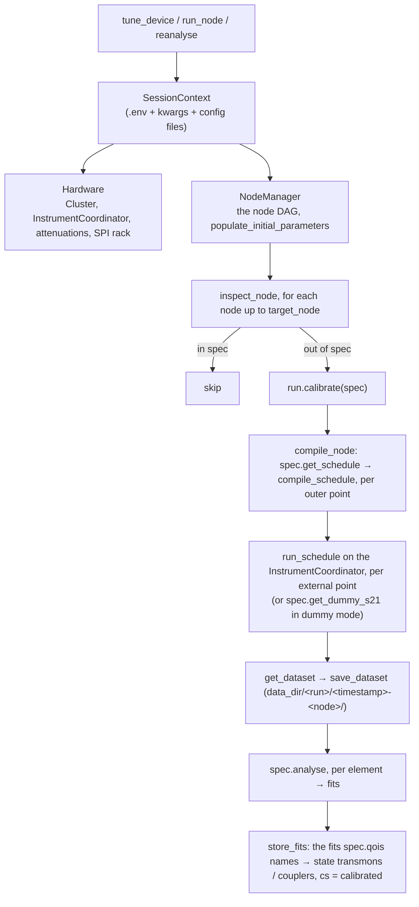

# Tergite Tuner — Design

A map of the tuner for contributors: its parts, how a calibration run flows from an entry point
to the hardware and back, and where each kind of code lives. How to use it is in the
[README](README.md) and [docs/](docs); how to test it and the code conventions are in
[CONTRIBUTING.md](CONTRIBUTING.md).

## What it is

A Python library (3.13) that a program imports to tune up a chip: tergite-backend, a notebook,
or a script. It is a stripped-down fork of
[tergite-autocalibration](https://github.com/tergite/tergite-autocalibration), without its CLI,
GUI or dataset browser.

| Part | Path | Role |
| --- | --- | --- |
| Entry points | `tergite_tuner/tuner.py`, `export.py` | `tune_device`, `run_node`, `reanalyse`, `read_result`, `generate_calib_seed_file` |
| Configuration | `tergite_tuner/config/` | `SessionContext`, and models of the four config files |
| Nodes | `tergite_tuner/lib/nodes/` | one package per calibration experiment |
| Node machinery | `tergite_tuner/lib/spec.py`, `lib/run.py` | a node as a `NodeSpec`, and running one: sweep, measure, build the dataset, analyse, plot, store |
| Device state | `tergite_tuner/state.py`, `storage/fs/` | `DeviceState`: the device's parameters and calibration statuses; `fs/` writes each node's dataset |
| Backend | `tergite_tuner/backend/` | everything from quantify-scheduler and qblox-instruments: operations, the device model, compiling and running schedules, and `Hardware` (the cluster and the SPI rack) |

It depends on quantify-scheduler 0.22 and qblox-instruments 0.14, as tergite-backend does. The
move to qblox-scheduler 1.0 is on the `feature/qblox-scheduler` branch.

## A calibration run



1. **The session.** `SessionContext.from_env` reads the `.env` file, then environment variables,
   then keyword arguments (the last wins), and loads the four config files. It carries the
   run's `DeviceState`.
2. **The graph.** `DEFAULT_NODE_DAG_EDGES` (in `lib/nodes/__init__.py`) lists `(parent, child)`
   edges; `DEFAULT_NODE_SPECS` maps each `NodeEnum` to its `NodeSpec`, which the session's
   `node_specs` can replace or add to. `NodeManager.topo_order` walks the ancestors of
   `target_node` in order, leaving out `ignored_nodes`.
3. **Each node.** `inspect_node` reads the node's status in the state's `cs`, and skips a node
   in spec. Otherwise the node's `node_config` section is laid over the state while it runs; a
   recalibration keeps it for the nodes after.
4. **Measuring.** `run.measure` compiles the node's schedule over its `sweeps` and runs it:
   - once per point of its `outer_sweeps`, compiling again for each, for sweeps too large for
     the instrument's memory;
   - once per point of its `external_sweeps`, calling `set_external` before each (to set an SPI
     current, or to wait) and `reset_external` after.

   Each outer or external sweep adds a dimension to the dataset.
5. **Analysing.** `run.analyse_node` gives each element its data: a qubit node gets the
   qubit's complex S21, a coupler node the coupler's variables. The node's `analyse` returns
   the element's fits, each a `Fit(value, error)`, or marks them failed. `store_fits` writes
   the successful fits to the state fields the node's `qois` name, and marks each element
   `calibrated` or `not_calibrated`. With `save_plot`, `plot_elements` plots them.

**Modes.** `cluster_mode` is `real`; `dummy`, a dummy cluster whose acquisitions are replaced
by each node's `generate_dummy_dataset`; or `re_analyse`, no hardware, where `reanalyse` runs a
node's analysis on recorded data. `spi_mode` is `real` or `dummy`.

## Code map

```
tergite_tuner/
├── __init__.py            the public API
├── tuner.py               tune_device, run_node, reanalyse; NodeManager
├── export.py              read_result, generate_calib_seed_file, CalibrationResults
├── exc.py                 TunerError and its subclasses
├── backend/               the only package that imports quantify-scheduler and qblox-instruments
├── config/
│   ├── session.py         SessionContext, SessionOptions
│   └── types/             DeviceConfig, NodeConfig, SpiConfig, ClusterConfig
├── lib/
│   ├── spec.py, run.py    NodeSpec, and running one
│   ├── nodes/             readout/, qubit_control/, characterization/, coupler/: one package per node
│   │   └── <group>/<node>/   node.py, measurement.py, analysis.py, tests/
│   └── utils/             the schedules' shared building blocks, fit models, the DAG
├── state.py               DeviceState: the run's device values and calibration statuses
├── storage/
│   └── fs/                datasets and node data folders
├── utils/                 logging, enums, NodeEnum
└── tests/                 cross-cutting tests; utils/ holds the shared test helpers
conftest.py                the session_context and seeded_state fixtures
```

## Data

The session's `DeviceState` holds the device as the run knows it. It starts from the device
config's values for the session's qubits and couplers, with the session's `calibration` (an
earlier run's results) laid over them. Nothing else carries over between sessions.

| Collection | Holds |
| --- | --- |
| `transmons` | each qubit's parameters, nested; read by colon-separated path (`rxy:amp180`, `clock_freqs:f01`), each stored fit beside its `_error` |
| `couplers` | each coupler's parameters (`parking_current`, `cz_pulse_amplitude`, …) |
| `cs` | each element's calibration status per node: `calibrated` or `not_calibrated` |

- `read_result` returns the fields the session's nodes wrote, or everything, as
  `CalibrationResults`.
- `generate_calib_seed_file` turns them into the TOML seed tergite-backend reads.

**Files.** Each run writes a folder under `data_dir`, holding `results.json` (which a later
session can take as `calibration`) and a folder per measured node: its dataset
(`dataset_<node>.hdf5`), the device's serialised elements (`<node>.json`) and its plots. A
recalibration's nodes write straight into the run's folder. `keep_data_files=False` deletes
the run's folder, and nothing else in `data_dir`.

## Configuration

A run is configured by `SessionContext` fields (from `.env`, the environment or keyword
arguments) and four files: the chip (`device_config.toml`), per-node overrides
(`node_config.toml`), the SPI rack's wiring (`spi_config.toml`) and quantify-scheduler's
hardware config (`cluster_config.json`). Each file can also be passed as an object. See
[docs/configuration.md](docs/configuration.md).
