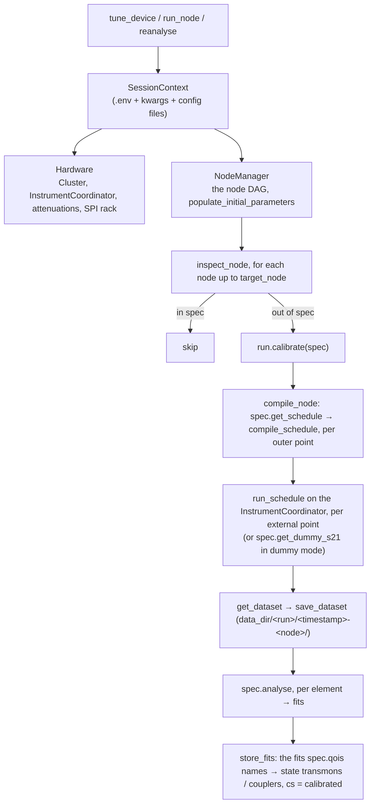

# Tergite Tuner — Design

This document describes the architecture of `tergite-tuner`, a library that calibrates the WACQT quantum computers: how a calibration run flows from an entry point to the hardware and back into the session, where each kind of code lives, how it is configured and tested, and the conventions a contributor is expected to follow. [REFACTOR.md](REFACTOR.md) is the plan that is moving the code towards these conventions; where the two differ, the code is mid-refactor and this document describes what is there.

## 1. What this repo is

A Python library (3.13+) that a program imports to tune up a chip: tergite-backend, a notebook, or a script. It is a stripped-down fork of [tergite-autocalibration](https://github.com/tergite/tergite-autocalibration), without its CLI, GUI or dataset browser.

| Part | Path | Role |
| --- | --- | --- |
| Entry points | `tergite_tuner/tuner.py`, `export.py` | `tune_device`, `run_node`, `reanalyse`, `read_result`, `generate_calib_seed_file` |
| Configuration | `tergite_tuner/config/` | `SessionContext` and the four config files' models |
| Nodes | `tergite_tuner/lib/nodes/` | one package per calibration experiment |
| Node machinery | `tergite_tuner/lib/spec.py`, `lib/run.py` | a node as a `NodeSpec`, and running one: sweep, measure, shape the dataset, analyse, plot, store |
| Device state | `tergite_tuner/state.py`, `storage/fs/` | the session's `DeviceState` holds the device's parameters and calibration statuses; `fs/` writes each node's dataset |
| Backend | `tergite_tuner/backend/` | everything taken from quantify-scheduler and qblox-instruments: the operations, the device model (our transmon and edge, extended with our gates and parameters), compiling and running schedules, and `Hardware`: the Qblox cluster and the SPI rack's current sources |

It depends on quantify-scheduler 0.22 and qblox-instruments 0.14, as tergite-backend does. The move to qblox-scheduler is step 11 of the refactor.

## 2. A calibration run



1. **The session.** `SessionContext.from_env` reads the `.env` file, then the environment variables that name a field, then the keyword arguments, and loads `device_config`, `node_config`, `spi_config` and `cluster_config` from their paths. It is the run's context, and carries the run's `DeviceState` with it.
2. **The graph.** `DEFAULT_NODE_DAG_EDGES` in `lib/nodes/__init__.py` lists `(parent, child)` edges, and `DEFAULT_NODE_SPECS` maps each `NodeEnum` to its `NodeSpec`, which the session's `node_specs` can replace or add to. `NodeManager.topo_order` walks the ancestors of `target_node` in topological order, leaving out `ignored_nodes`.
3. **Each node.** `inspect_node` reads the node's status in the state's `cs`. A node in spec is skipped. Otherwise its `node_config` section goes over the state while it is built, measured, saved and analysed; a recalibration keeps it for the nodes after.
4. **Measuring.** `run.measure` compiles the spec's schedule over its `sweeps`, and runs it once per point of its `outer_sweeps` (compiled again per point, for sweeps too large for the instrument's memory) and of its `external_sweeps` (calling `set_external` before each, to set an SPI current or to wait, and `reset_external` after). Each run's dataset gains a dimension per outer or external setting.
5. **Analysing.**
   - `run.analyse_node` gives each element its data: a qubit node's `analyse` gets the qubit's complex S21, a coupler node's the coupler's variables.
   - `analyse` returns the element's fits, each a `Fit(value, error)`, or None, or fits marked `failed`, when the element failed. The spec's `qois` names the state's field each stored fit goes to.
   - `store_fits` writes the successful ones into the state and marks each element `calibrated`, or `not_calibrated` where it failed; `plot_elements` plots when `save_plot` is set.

**Modes.** `cluster_mode` is `real`, `dummy` (a dummy cluster, and each node's `generate_dummy_dataset` in place of acquisitions) or `re_analyse` (no hardware; `reanalyse` runs the target node's analysis on `data_dir`). `spi_mode` is `real` or `dummy`.

## 3. Layout

```
tergite_tuner/
├── __init__.py            the public API
├── tuner.py               tune_device, run_node, reanalyse; NodeManager
├── export.py              read_result, generate_calib_seed_file, CalibrationResults
├── exc.py                 TunerError and its subclasses
├── backend/               the only package that imports quantify-scheduler and qblox-instruments
├── config/
│   ├── session.py         SessionContext, SessionOptions
│   └── types/             DeviceConfig, NodeConfig, SpiConfig, ClusterConfig
├── lib/
│   ├── spec.py, run.py    NodeSpec, and running one
│   ├── nodes/             readout/, qubit_control/, characterization/, coupler/: one package per node
│   │   └── <group>/<node>/   node.py, measurement.py, analysis.py, tests/
│   └── utils/             the schedules' shared building blocks, fit models, the DAG
├── state.py               DeviceState: the run's device values and calibration statuses
├── storage/
│   └── fs/                datasets and node data folders
├── utils/                 logging, enums, NodeEnum
└── tests/                 cross-cutting tests; utils/ holds the shared test helpers
conftest.py                the session_context and seeded_state fixtures
```

## 4. Data

The session's `DeviceState` holds the device as the run knows it. It starts from `device_config`'s values for the session's qubits and couplers, with the session's `calibration`, an earlier run's results, over them. Nothing else carries over between sessions.

| Collection | Holds |
| --- | --- |
| `transmons` | each qubit's parameters, nested; read by colon-separated path (`rxy:amp180`, `clock_freqs:f01`), each stored fit beside its `_error` |
| `couplers` | each coupler's parameters (`parking_current`, `cz_pulse_amplitude`, …) |
| `cs` | each element's calibration status per node: `calibrated` or `not_calibrated` |

`read_result` returns the fields the session's nodes wrote, or everything, as `CalibrationResults`. `generate_calib_seed_file` turns that into the TOML seed tergite-backend reads.

Each run writes a folder under `data_dir`, with its results in `results.json`, which a later session takes as `calibration`, and each measured node a folder in it: the dataset (`dataset_<node>.hdf5`), the device's serialised elements (`<node>.json`), and its plots. A recalibration's nodes write straight into the run's folder. `keep_data_files=False` deletes the run's folder, and nothing else in `data_dir`.

## 5. Configuration

| Source | Holds |
| --- | --- |
| `.env` / `SessionContext` fields | cluster IP and mode, SPI port and mode, qubits, couplers, target node, flags, an earlier `calibration`, the paths below. See [.example.env](.example.env) |
| `device_config.toml` | the chip: initial qubit, resonator and coupler values, under `all` or per element |
| `node_config.toml` | per-node overrides that sit over the state while the node runs, under `all` or per qubit |
| `spi_config.toml` | which SPI module and DAC drives each coupler |
| `cluster_config.json` | quantify-scheduler's hardware compilation config |

Each can also be passed as an object. The README shows both.

## 6. Testing

`pytest tergite_tuner -n auto`, in parallel with pytest-xdist. CI runs it serially: in its containers, parallel runs were slower. `-m 'not slow'` leaves out the dummy run of every node and the compile of every outer-sweep point: about 35 s against 1 m 45 s for everything, on a 12-core MacBook. `conftest.py` at the repository root builds the session from the test configs in `tergite_tuner/tests/fixtures/`.

- Each node's tests live in its `tests/` folder, beside the recorded datasets they analyse (`tests/data/`).
- Shared helpers live in `tergite_tuner/tests/utils/`, grouped by what they do: `fixtures.py`, `state.py`, `runs.py`, `pytest.py`. A test's device state is JSON that `DeviceState` takes as is, in the shape `results.json` has.
- `tests/test_precompile.py` compiles every default node against the test cluster config.
- `tests/test_public_api.py` calls `tune_device`, `run_node` (with a custom node class too) and `reanalyse` as the README does; `tests/test_export.py` covers `read_result` and the seed file.
- `tests/test_schedule_goldens.py` pins a digest of every default node's compiled program in `tests/fixtures/goldens/schedules.json`, rewritten with `UPDATE_GOLDENS=1` when a change alters a program on purpose.
- `tests/test_reanalysis_goldens.py` reruns 19 nodes' analyses on recorded datasets and compares the QOIs with `tests/fixtures/goldens/`. A change that moves a value on purpose rewrites its golden with `UPDATE_GOLDENS=1`, and its commit says why.
- `tests/test_tune_up.py` runs every default node in dummy mode, end to end, on a calibrated device from `tests/fixtures/states/standard_state.json`. It is marked `slow`, with `test_precompile.py`'s compile of every outer-sweep point.

A test that changes module state resets it: call `ExtendedTransmon.close_all()` before building a device, and restore a matplotlib backend you change.

### Performance

`dev/perf/record.sh <dir>` records each node's compile, dataset assembly and analysis (time and peak memory, `dev/perf/test_nodes.py`), the dummy run of every node, the fast tests, the import and the install size (`dev/perf/record_runs.py`). `python -m dev.perf.compare dev/perf/baselines/<machine> <dir>` exits 1 when a measure is more than 15% worse than that machine's baseline, past a noise floor. Timings depend on the machine, so each has its own baseline: `macos-arm64` now, `ci` once the CI job's first recording is committed. A refactor step is signed off only when its recording compares clean.

## 7. CI

GitLab CI ([.gitlab-ci.yml](.gitlab-ci.yml)) and GitHub Actions ([.github/workflows/ci.yml](.github/workflows/ci.yml)) run the same job on Python 3.13, on every merge request, on `main` and on tags: `uv sync --locked`, which fails on a stale `uv.lock`; `black --check`; the ruff, pylint and vulture baselines; then pytest with coverage, which includes the style-guide test. A `v*` tag on GitHub also builds and publishes the package. GitLab is the source of truth; GitHub is a mirror.

## 8. Working on this repo

### Versioning and releases

`{year}.{month}.{patch}`, e.g. `2026.06.0`. A release sets the version in `pyproject.toml` and dates the `[Unreleased]` section of [CHANGELOG.md](CHANGELOG.md).

### Changelog entries

One or two sentences: what changed, and what a user would have hit before. Always under `[Unreleased]`, under `Added` / `Changed` / `Fixed`. The reasoning belongs in the commit body.

### Commits

One logical change per commit, decided before editing. Never add assistant attribution to commit messages or merge request bodies.

### Slow commands

Redirect a test run to a file and read the file, rather than re-running it:

```bash
pytest tergite_tuner > "$LOG" 2>&1; echo "exit=$?" >> "$LOG"
```

Record the exit status beside it: a pipe reports its own status, so `pytest | tail` reads as green when the suite failed.

### Code structure

The conventions are tergite-frontend's, so the two read alike. Code reads like an article: the overview first, the detail below it.

1. **A function is a composition of functions.** A public function's body is a short sequence of calls, each to a function that does one thing and is named for it. Do not extract a step that would be a one-line function.
2. **Callees sit below their callers.** A file runs: constants, public functions in the order a caller uses them, then private helpers in the order they are first called.
3. **A comment that labels a phase is a missing function.**
4. **Data is a struct; state gets a class.** A node definition, a sweep, a fit or a config is a Pydantic model, frozen dataclass or named tuple. The Cluster connection, the SPI rack and the device state are classes. A class that holds only what its single method needs is a function.
5. **Stateless behaviour is a module-level function**, taking explicit arguments. No inheritance used only to share behaviour, no ABC with one implementation.
6. **Dependencies arrive as arguments.** Only the entry points turn configuration into instances. A function is given the store, the cluster or the value it needs, not the whole session.
7. **A library never takes over its host.** No `quit()`, no `matplotlib.use()`, no write to another package's globals that outlives the call, no write into the installed package. Errors are `TunerError`s from `exc.py`.
8. **One home per kind of thing.** The scheduler is imported in one package (from refactor step 5), device values are read from the session's state, tooling in `dev/`, shared test helpers in `tests/utils/`.
9. **Physics constants are named once**, at the top of the module that owns them.
10. **A reputable library beats our own code.** Write our own only where no library does the job, or where getting the behaviour would mean fighting it; the commit says which.
11. **A name says what the thing is.** Variables are nouns, functions verbs, booleans `is_`/`should_`. No `build_*`: a constructed thing is a class's constructor, anything else is a `get_*`.
12. **Obvious beats clever.** An `if`/`else` that returns each whole literal; no comprehension that assembles operators, no helper that returns two things to be pulled apart.
13. **A value that is only defined stays where it is used.** A function that only returns a literal makes the reader jump for nothing.

### Lint

`black` formats. `ruff check` lints, with the isort rules (no separate isort); `pylint` checks duplicate code and function size; `vulture` finds unused definitions. Each has a baseline of the findings that predate it in `dev/lint/`:

```bash
uv run python -m dev.lint.baseline ruff      # or pylint, vulture
uv run python -m dev.lint.baseline ruff --update
```

The check fails on a finding the baseline lacks, and on an entry it no longer finds. A commit that fixes a finding runs `--update` and commits the shorter baseline; no commit adds to it.

`tergite_tuner/tests/test_styleguide.py` checks the rules below that a parser can see and the linters cannot: verbs, booleans, file order, banners, the licence header, `__all__`, type hints, the import layers (`utils` < `storage`, `config` < `lib` < `tuner`, `export`), quantify-scheduler and Redis each imported in one package only, and no host takeover. Its baseline is `tests/fixtures/styleguide_baseline.txt`, which only shrinks. A new verb is added to its `VERBS` in review, never to the baseline.

### Python style

- **Comments and docstrings earn their place**: the constraint, the gotcha, the why the code cannot say. One line where one line does. Never narrate the history of a fix.
- **Constants at the top** of the file, after imports, except one built from a function or class defined in the same file. **Module-private helpers at the bottom.**
- **No banner comments** at any indent.
- **Tests**: the name says what is tested; a comment only when the why is not obvious.
- **License header** on every file: copy the block from a neighbouring module, and add a copyright line per contributing party.
- **Type hints** on every public function.

### Adding a node

| Task | Where |
| --- | --- |
| A new calibration node | a package under `lib/nodes/<group>/<node>/` with `node.py` (its `NodeSpec`: name, element, schedule, sweeps, analysis, QOIs, dummy model), `measurement.py`, `analysis.py`, and `tests/` with a recorded dataset |
| Run it in the default graph | a `NodeEnum` member, its spec in `DEFAULT_NODE_SPECS`, and its edges in `DEFAULT_NODE_DAG_EDGES` |
| A new device parameter | the extended transmon or edge in `backend/transmon.py` or `backend/edge.py`, and its initial value in `device_config.example.toml` |
| A new session option | a `SessionContext` field, `SessionOptions`, and `.example.env` |
